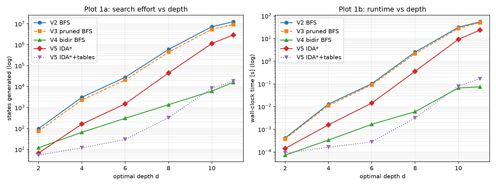
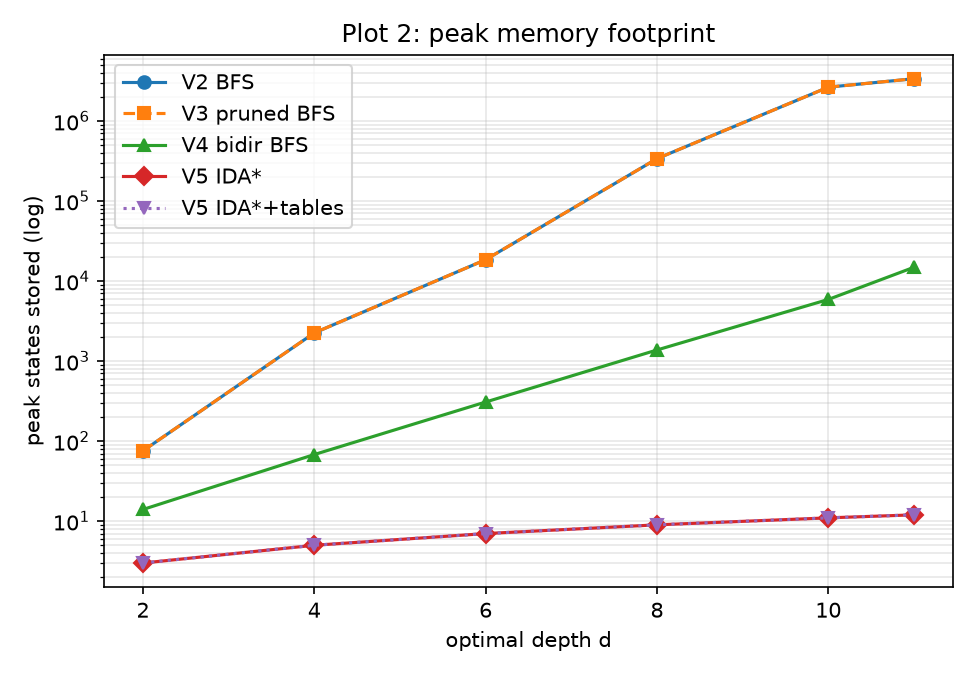

# Problem 2 — Pocket Rubik's Cube & State-Space Search

Algorithms and Data Structures, guided examination.

The 2×2×2 Pocket Cube treated as a shortest-path problem on an implicit graph of 3,674,160 states, solved by five versions:

| Version | Representation | Search |
|---|---|---|
| V1 | 24-sticker array | depth-limited DFS (not optimal) |
| V2 | `(perm, orient)` tuples | BFS + hash map |
| V3 | tuples | BFS with redundant-move pruning |
| V4 | tuples | bidirectional BFS |
| V5 | tuples | IDA* with admissible corner heuristic (+ optional pattern tables) |

## Run

```
pip install matplotlib jupyter
jupyter notebook Problem2_PocketCube.ipynb
```

A full run takes about 6 minutes and about 2 GB of RAM (V2/V3 at depth 11). Set `QUICK = True` in the benchmark cell for a faster run, or `RUN_FULL_BFS = False` to skip the 40-second full state-space BFS.

## Results at optimal depth 11

| Version | States generated | Peak states stored | Time |
|---|---|---|---|
| V2 BFS | 12,658,708 | 3,370,251 | 25.3 s |
| V3 pruned BFS | 9,397,398 | 3,370,251 | 30.6 s |
| V4 bidirectional BFS | 16,158 | 14,857 | 0.06 s |
| V5 IDA* | 2,965,049 | 12 | 5.4 s |
| V5 IDA* + pattern tables | 18,332 | 12 | 0.04 s |




Group members: *(add names)*
